# Using LiteMongo

A practical tour of LiteMongo, the lightweight MongoDB client for developers and jump hosts. It covers connecting, querying, linking collections and browsing them in the nested table. It also covers saving views, multi-step fetch recipes and script mode.

## Contents

1. [Getting started](#1-getting-started)
2. [Connections](#2-connections)
3. [Querying a collection](#3-querying-a-collection)
4. [Linking collections](#4-linking-collections)
5. [The nested table](#5-the-nested-table)
6. [Columns](#6-columns)
7. [Saved views](#7-saved-views)
8. [Fetch recipes](#8-fetch-recipes)
   - [Running a template](#running-a-template)
   - [Fetch algorithms](#fetch-algorithms)
   - [Dossier, Board, Trace and JSON](#dossier-board-trace-and-json)
   - [Writing your own recipe](#writing-your-own-recipe)
9. [Script mode](#9-script-mode)
10. [Workspace config](#10-workspace-config)
11. [Installing the desktop app](#11-installing-the-desktop-app)
    - [Windows](#windows)
    - [macOS](#macos)
    - [Linux](#linux)
12. [Keyboard shortcuts](#12-keyboard-shortcuts)

---

## 1. Getting started

LiteMongo runs in three ways. Each way uses the same user interface.

| Option | Description |
|---|---|
| **Desktop app** | A standalone window for Windows, macOS and Linux with the server built in. See [Installing the desktop app](#11-installing-the-desktop-app). |
| **Docker container** | A single stateless container for a jump host. Open its port in a browser. |
| **From source** | `npm run dev` starts the API on port 3001 and the UI on <http://localhost:5173>. |

The repository includes a local MongoDB 8 with insurance sample data, which every screenshot below uses:

```bash
docker compose up -d        # MongoDB 8 on localhost:27017, seeded with sample data
npm install
npm run dev                 # or: npm run desktop:dev for the desktop window
```

> [!NOTE]
> In development and in the desktop app, LiteMongo pre-fills a **Local Docker Dev** connection that points at this database, so you can start querying right away.

## 2. Connections

Connections are listed in the left sidebar. Click **+** next to *Connections* to add one. You can fill in host, port, credentials and options, or paste a full connection string.

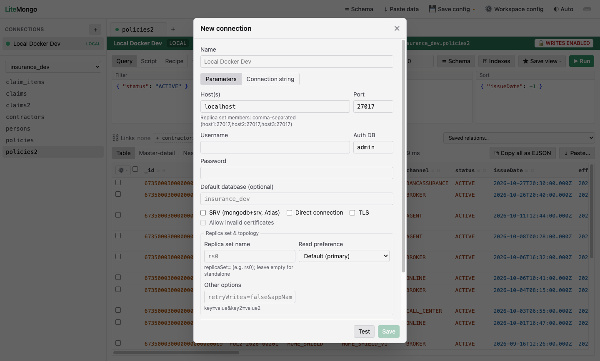
*The connection dialog. **Test** checks the connection before you save it.*

- **Environment.** Every profile has an environment: PROD and CLIENT (red), TEST (orange), or DEV and LOCAL (green). The colour shows in the banner above every tab, so you always know where you are.
- **Read-only lock.** The 🔒 button in the banner blocks every write: pasting data, writes from scripts, and document updates and deletes. PROD and CLIENT connections are always read-only.
- **Where profiles live.** Profiles are stored only in your browser or desktop app. The server never stores connection strings.

## 3. Querying a collection

Pick a database and a collection in the sidebar. Each tab has three editors, *Filter*, *Projection* and *Sort*, plus a *Limit*. They use MongoDB's own syntax and offer autocomplete from your documented schema. Press <kbd>Ctrl/⌘</kbd>+<kbd>Enter</kbd> or **▶ Run** to run the query.

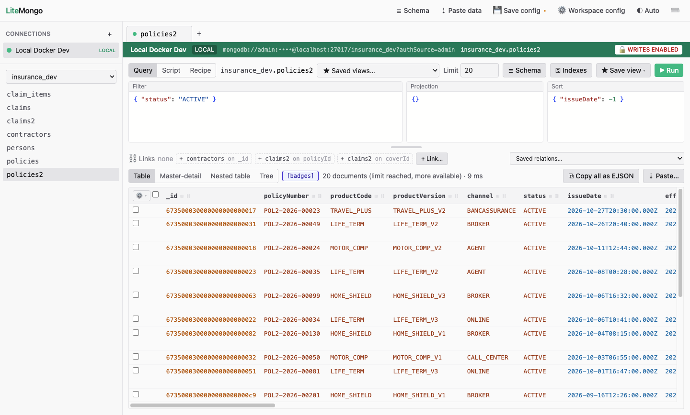
*The query workspace with a filter and a sort, showing results in the flat **Table** view.*

The same results can be shown four ways. Switch between them with the buttons above the results, or press <kbd>Alt</kbd>+<kbd>V</kbd>.

| View | Best for |
|---|---|
| **Table** | Scanning top-level fields. Click a row to unfold its document. |
| **Master-detail** | A master grid with panes below it for linked collections and embedded arrays. |
| **Nested table** | Rows that unfold in place into the tables of their details. See [section 5](#5-the-nested-table). |
| **Tree** | Key / value / type view for deeply nested documents. |

Click the small ⊞ icon in any column header to see that field's distinct values and how often each appears. **⚿ Indexes** lists the indexes on the collection.

## 4. Linking collections

A *link* joins another collection to your results, for example `policies2._id = claims2.policyId`. LiteMongo does not use `$lookup`. It fetches the root documents, collects their keys and runs **one** `$in` query per linked collection. This stays fast and safe on production servers.

The quickest way to add a link is to click one of the dashed suggestions after *Links*, such as `+ claims2 on policyId`. LiteMongo suggests links from your schema's documented foreign keys and from field names. For full control, click **+ Link…**:

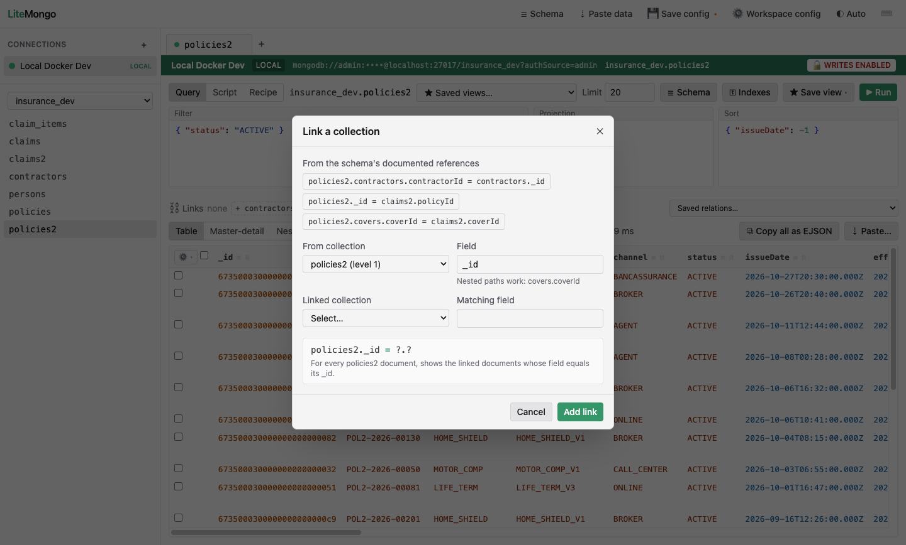
*The link dialog. Pick a documented reference, or choose the field on each side yourself. Nested paths such as `covers.coverId` work too.*

Links can be up to three levels deep, for example policies → claims → claim items. Several collections can hang off the same parent. To reuse a set of links, save it under *Saved relations…*. To save it together with the rest of the query, use a [saved view](#7-saved-views).

## 5. The nested table

The **Nested table** view is the richest way to browse related data. Each master row unfolds in place into the tables of its details, and each detail row can unfold again.

- **⛓ Linked collections** (green): documents from linked collections.
- **▤ Embedded arrays** (blue): for example `covers[]`.
- **◇ Embedded objects** (violet): for example `premium`. These are off by default.

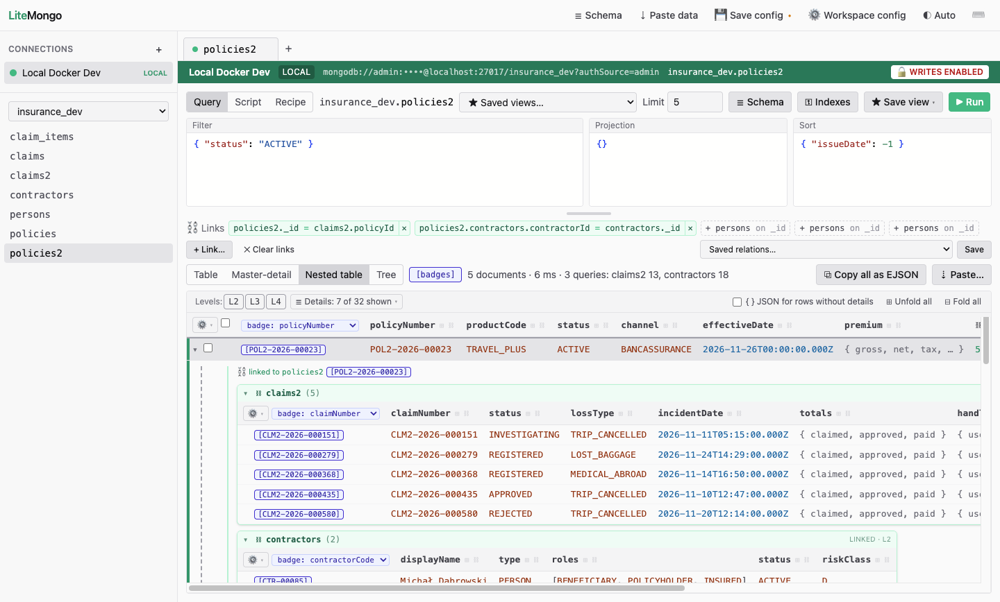
*A policy with two links. Its claims and contractors appear as tables right under the row.*

Use **☰ Details** to choose which sections appear under every row. The **L2 / L3 / L4** buttons switch a whole level on or off, and *sub: off* hides everything under one section. **⊞ Unfold all** and **⊟ Fold all** open or close every row.

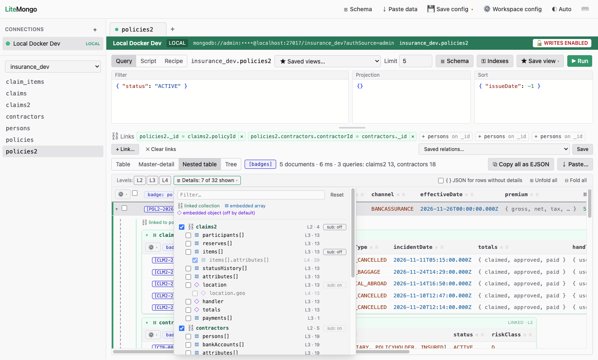
*The Details picker shows every section as a tree, with how many rows contain it.*

> [!TIP]
> The `[badges]` toggle shows a readable code for each row, such as `[POL2-2026-00023]` or `[TRIP_CANCELLED]`. Choose the badge field with the *badge:* dropdown in any table header. The choice is stored in your workspace schema.

## 6. Columns

Every table, including each nested detail table, has a **⚙** button in its first header cell. It opens the column chooser:

- Tick or untick columns to show or hide them. *all*, *none* and *reset* act on every column at once.
- Drag the ⋮⋮ handle, or use the ↑ ↓ buttons, to reorder columns. The filter box helps with wide documents.
- You can also **drag a column header** straight to a new position in the table.

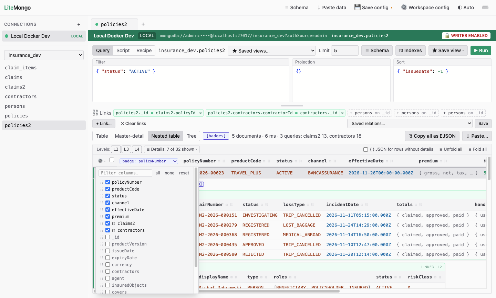
*The master table shows only policyNumber, productCode, status, channel, effectiveDate, premium and the two linked collections.*

Column settings are kept per tab, separately for each collection and each embedded array. For example, `claims2` keeps its own columns wherever it appears. Settings are saved with a [view](#7-saved-views).

## 7. Saved views

Once a tab looks the way you want, click **★ Save view**, type a name and press <kbd>Enter</kbd>. A view saves everything you set up:

- the collection, filter, projection, sort and limit;
- the links (joins);
- the view mode, for example the nested table;
- which detail sections are switched on;
- the column order and hidden columns of every table.

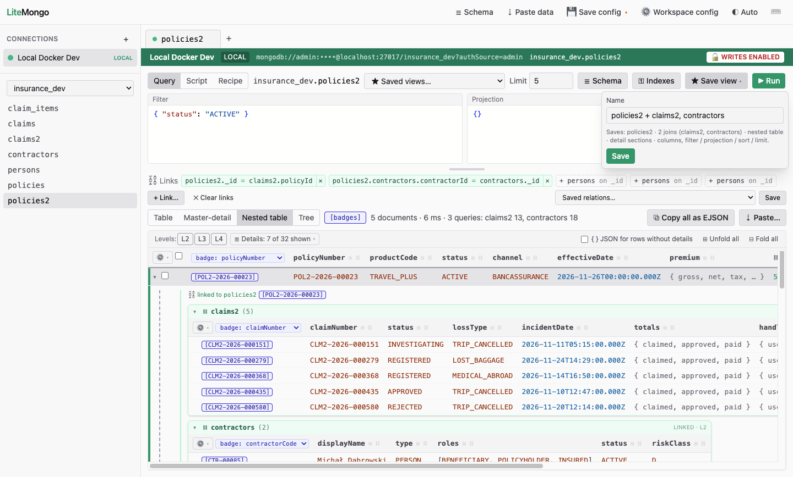
*The name is suggested from the collection and its links. The summary shows what the view will contain.*

Open a saved view from **★ Saved views…**. LiteMongo restores the tab and runs the query at once. If the tab came from a view, *Save view* offers **Update “name”**, **Save as new** and **Delete**. Views are stored in `litemongo.config.json`, so they travel with your workspace config.

## 8. Fetch recipes

A **recipe** is a saved, parameterised plan that fetches documents from several collections, one step after another. Each step chooses its own *fetch algorithm*. Recipes give you ready-made templates and a different way to present results. Switch a tab to **Recipe** with the Query / Script / Recipe switch.

### Running a template

Choose a template from the ⚗ picker. LiteMongo ships four templates that work on the sample data. You can add your own.

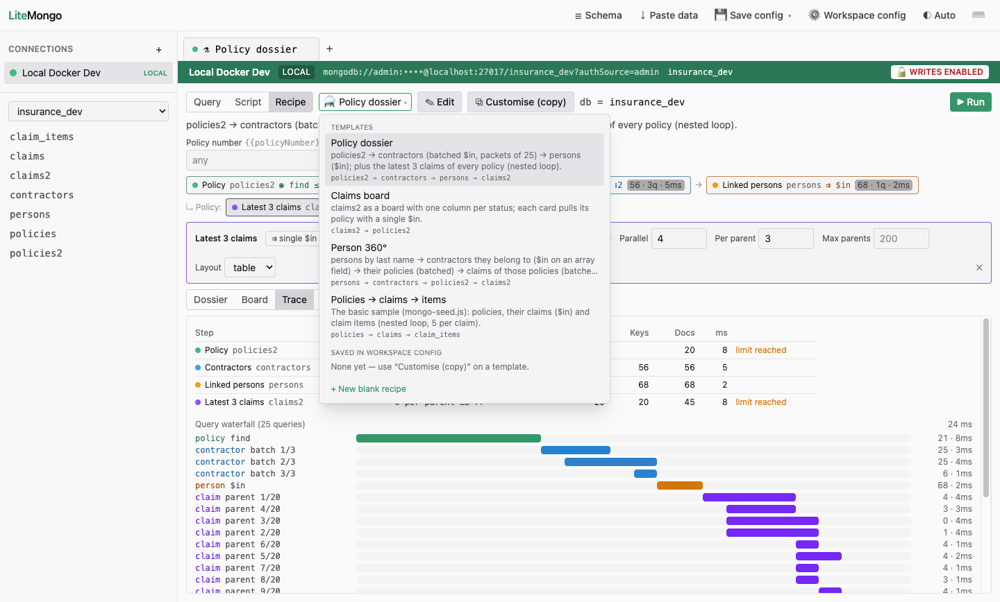
*Built-in templates. Each entry shows the collections it reaches, in order.*

Fill in the parameters and press **▶ Run**. Leave an optional parameter empty to drop its condition from the filter. A row of step chips shows the plan. After a run, each chip shows the number of documents, queries and milliseconds for that step.

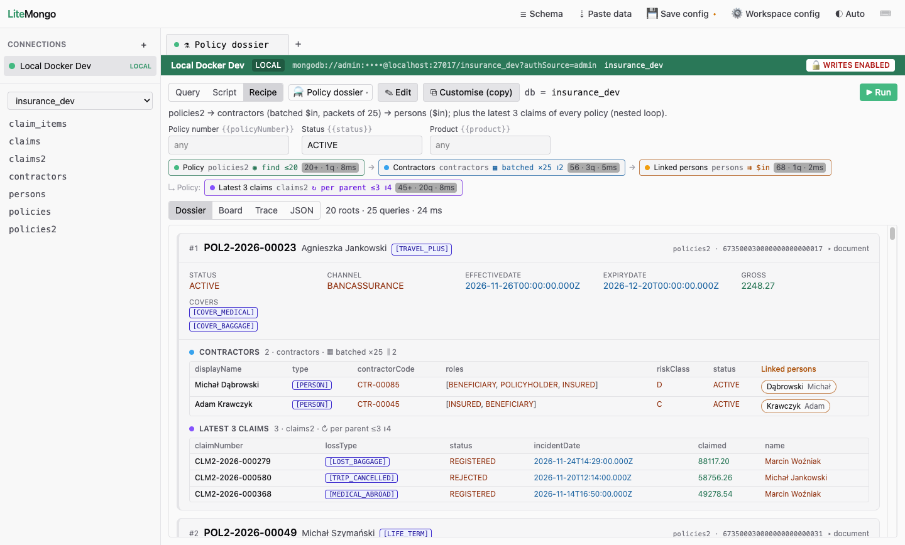
*The **Policy dossier** template in the Dossier view. It runs 25 queries for 20 policies, with contractors, their persons and the latest 3 claims of each policy.*

### Fetch algorithms

| Algorithm | What it does | Use it when |
|---|---|---|
| `⇉ $in` | One query for all parents: `{ foreignField: { $in: [unique parent keys] } }`. Results are matched to their parents in memory. | Most of the time. It is the cheapest option. |
| `▦ batched` | Parent keys are sent in packets of `batchSize`, with `concurrency` packets in flight at once. | There are thousands of keys, or the server is busy. This avoids one huge `$in`. |
| `↻ nested loop` | One query per parent document, each with its own sort and limit. | You need the top N per parent, for example *the latest 3 claims of every policy*, which one `$in` cannot do. |

Click a step chip to tune it without editing JSON. You can change the algorithm, packet size, parallelism, per-parent limit and how its documents are laid out.

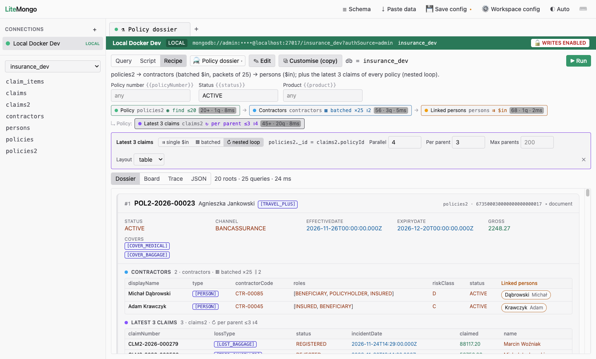
*The step tuner for a nested-loop step.*

> [!NOTE]
> Recipes only ever run `find()`, so they are read-only by design. Each run also has safety limits: at most 2,000 queries, a time limit on every query, and a maximum number of parents in a nested loop.

### Dossier, Board, Trace and JSON

- **Dossier.** One card per root document: a title, a badge and its key fields, followed by a section for each later step. A section can show its documents as cards, a compact table or chips.
- **Board.** Root documents as cards in columns, grouped by any field, such as claim status. Change the grouping field with *Columns by*.
- **Trace.** A summary per step (queries, keys, documents, time) and a waterfall of every query the algorithm ran. It makes batches running side by side and per-parent loops visible.
- **JSON.** All the fetched data, nested, as Extended JSON.

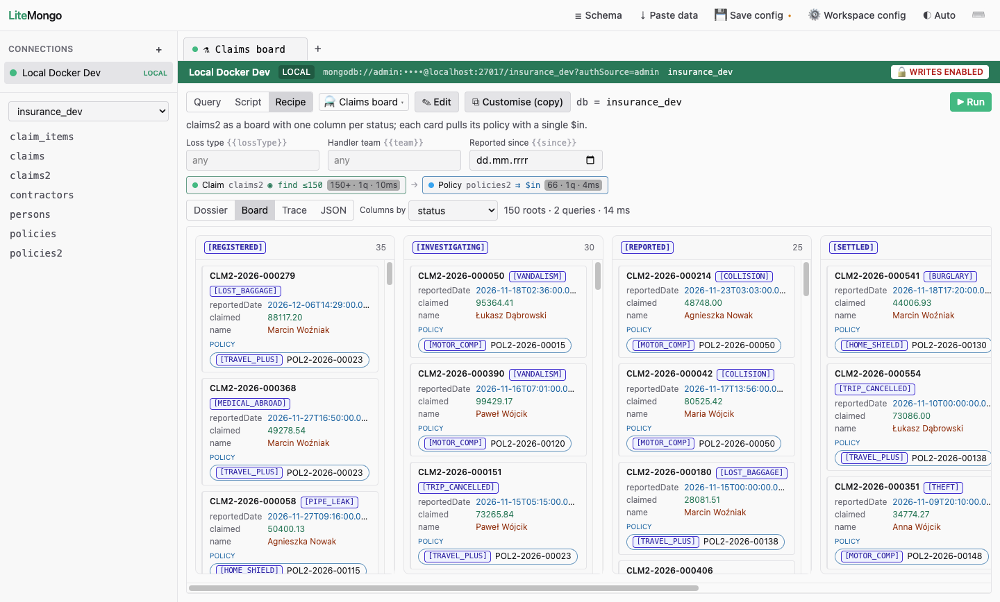
*The **Claims board** template: 150 claims in columns by status. Each card shows its policy, fetched with a single `$in`.*

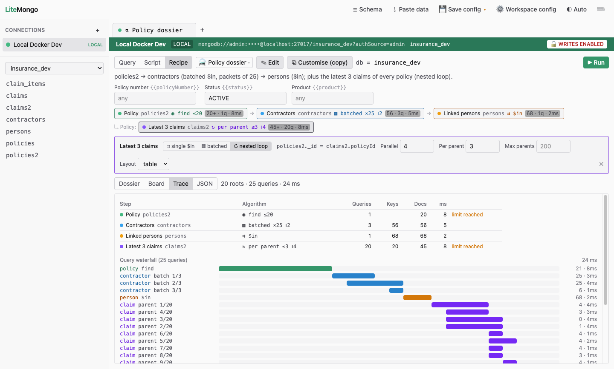
*The Trace view. Two contractor batches run in parallel, then one `$in` for persons, then the nested loop over claims.*

### Writing your own recipe

Click **⧉ Customise (copy)** on a template to save an editable copy in your workspace config. Then use **✎ Edit** (<kbd>Alt</kbd>+<kbd>E</kbd>) to edit it as JSON. LiteMongo validates the JSON as you type. A recipe looks like this:

```json
{
  "id": "latest-claims",
  "name": "Latest claims per policy",
  "params": [
    { "name": "status", "label": "Status", "default": "ACTIVE", "options": ["ACTIVE", "LAPSED"] },
    { "name": "since", "type": "date" }
  ],
  "steps": [
    { "id": "policy", "collection": "policies2",
      "filter": { "status": "{{status}}", "issueDate": { "$gte": "{{since}}" } },
      "sort": { "issueDate": -1 }, "limit": 20,
      "display": { "title": "policyNumber", "badge": "productCode", "fields": ["status", "premium.gross"] } },
    { "id": "claim", "collection": "claims2", "parent": "policy",
      "strategy": "nested-loop", "localField": "_id", "foreignField": "policyId",
      "sort": { "incidentDate": -1 }, "limit": 3,
      "display": { "title": "claimNumber", "layout": "table" } }
  ],
  "view": { "mode": "dossier" }
}
```

- `"{{param}}"` is replaced with the parameter value. The value gets the parameter's type: `string`, `number`, `objectId`, `date`, `boolean` or `json`. Placeholders also work inside text, for example `{ "$regex": "^{{q}}" }`.
- `"{{parent.path}}"` is available in `nested-loop` steps. It is replaced with the parent document's value at that path.
- `parent` names an earlier step. When you leave it out, the step uses the previous step as its parent.
- `batched` steps take `batchSize` and `concurrency`. `nested-loop` steps take `limit` (documents per parent), `concurrency` and `maxParents`.

## 9. Script mode

Switch a tab to **Script** to write mongosh-style JavaScript, such as `db.claims2.find(…).sort(…).limit(…)`, loops, variables and `print()`. The script runs inside your browser. The server only executes one database operation at a time and never runs your code. Write operations are blocked on read-only connections.

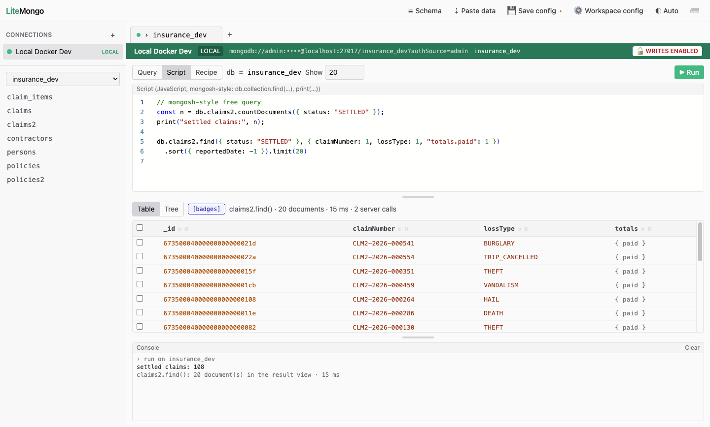
*The last expression's result appears in the table. `print()` output goes to the console.*

## 10. Workspace config

Schemas, saved relations, saved views, recipes and ID renumbering rules all live in one portable file, `litemongo.config.json`.

- **💾 Save config** (<kbd>Ctrl/⌘</kbd>+<kbd>S</kbd>) writes the file. After the first save, changes are saved to it automatically.
- **⚙ Workspace config** opens a validating editor and lets you import or export the config.
- **☰ Schema** (<kbd>Alt</kbd>+<kbd>S</kbd>) documents fields, enum values, ID paths and foreign keys. This drives autocomplete, link suggestions and badges.

To bring your setup to a jump host, copy the config there, or copy it back to your machine the same way.

## 11. Installing the desktop app

Installers are published on the GitHub Releases page. They are not code-signed yet, so each operating system asks you to confirm the first launch. This is expected.

| System | File |
|---|---|
| Windows (x64) | `LiteMongo Setup <version>.exe` (installer) or `LiteMongo <version>.exe` (portable, no install) |
| macOS (Apple Silicon) | `LiteMongo-<version>-arm64.dmg` or `LiteMongo-<version>-arm64-mac.zip` |
| Linux (x64) | `LiteMongo-<version>.AppImage` (any distribution) or `litemongo-desktop_<version>_amd64.deb` (Debian / Ubuntu) |

### Windows

1. Run `LiteMongo Setup <version>.exe`, or the portable `.exe` if you don't want to install anything.
2. Windows Defender SmartScreen shows *“Windows protected your PC”*. Click **More info**, then **Run anyway**.
3. The installer adds a Start menu entry. Later launches start without a warning.

> [!WARNING]
> If your antivirus quarantines the portable `.exe`, use the installer instead, or allow the file in the antivirus settings.

### macOS

1. Open the `.dmg` and drag **LiteMongo** into **Applications**.
2. The app is not signed with an Apple Developer certificate, so macOS may refuse to open it: *“LiteMongo is damaged and can't be opened”* or *“cannot be verified”*. Remove the quarantine flag once in Terminal:

   ```bash
   xattr -dr com.apple.quarantine /Applications/LiteMongo.app
   ```

3. Open LiteMongo normally. If macOS still blocks it, go to **System Settings → Privacy & Security** and click **Open Anyway**.

### Linux

**Debian / Ubuntu (.deb)**: recommended. It installs a menu entry and sets up Chromium's sandbox correctly:

```bash
sudo apt install ./litemongo-desktop_<version>_amd64.deb
litemongo-desktop            # or start LiteMongo from the application menu
```

**AppImage** (any distribution): make it executable and run it:

```bash
chmod +x LiteMongo-<version>.AppImage
./LiteMongo-<version>.AppImage
```

- If it fails with *“AppImages require FUSE to run”*, install FUSE 2: `sudo apt install libfuse2`. On Ubuntu 24.04 the package is `libfuse2t64`.
- On Ubuntu 23.10 and later, AppArmor can block Electron's sandbox. The error mentions *“The SUID sandbox helper binary was found, but is not configured correctly”*. Start it with `./LiteMongo-<version>.AppImage --no-sandbox`, or use the `.deb` instead.

### Good to know

- The desktop app runs its own local server on `127.0.0.1:38017`. To use another port, set `LITEMONGO_DESKTOP_PORT`.
- Connections, tabs and settings are stored in the app's local storage and survive updates.
- On first start, a *Local Docker Dev* connection to `localhost:27017` is added for the bundled `docker compose` database. Delete it if you don't need it.

## 12. Keyboard shortcuts

| Keys | Action |
|---|---|
| <kbd>Ctrl/⌘</kbd>+<kbd>Enter</kbd> | Run the query, script or recipe |
| <kbd>Alt</kbd>+<kbd>T</kbd> / <kbd>Alt</kbd>+<kbd>W</kbd> | New tab / close tab |
| <kbd>Alt</kbd>+<kbd>1</kbd>…<kbd>9</kbd>, <kbd>Alt</kbd>+<kbd>[</kbd> / <kbd>]</kbd> | Switch tabs |
| <kbd>Alt</kbd>+<kbd>V</kbd> | Next view mode |
| <kbd>Alt</kbd>+<kbd>L</kbd> | Link a collection |
| <kbd>Alt</kbd>+<kbd>F</kbd> / <kbd>Alt</kbd>+<kbd>G</kbd> | Focus the filter / the results grid |
| <kbd>Alt</kbd>+<kbd>C</kbd> / <kbd>Alt</kbd>+<kbd>P</kbd> | Copy results as an EJSON bundle / paste a bundle |
| <kbd>Alt</kbd>+<kbd>I</kbd> | Indexes |
| <kbd>Alt</kbd>+<kbd>S</kbd> | Schema manager |
| <kbd>Alt</kbd>+<kbd>E</kbd> | Recipe JSON editor (recipe mode) |
| <kbd>Alt</kbd>+<kbd>D</kbd> | Theme: system, then light, then dark |
| <kbd>Ctrl/⌘</kbd>+<kbd>S</kbd> | Save the workspace config |
| <kbd>?</kbd> | All shortcuts |
